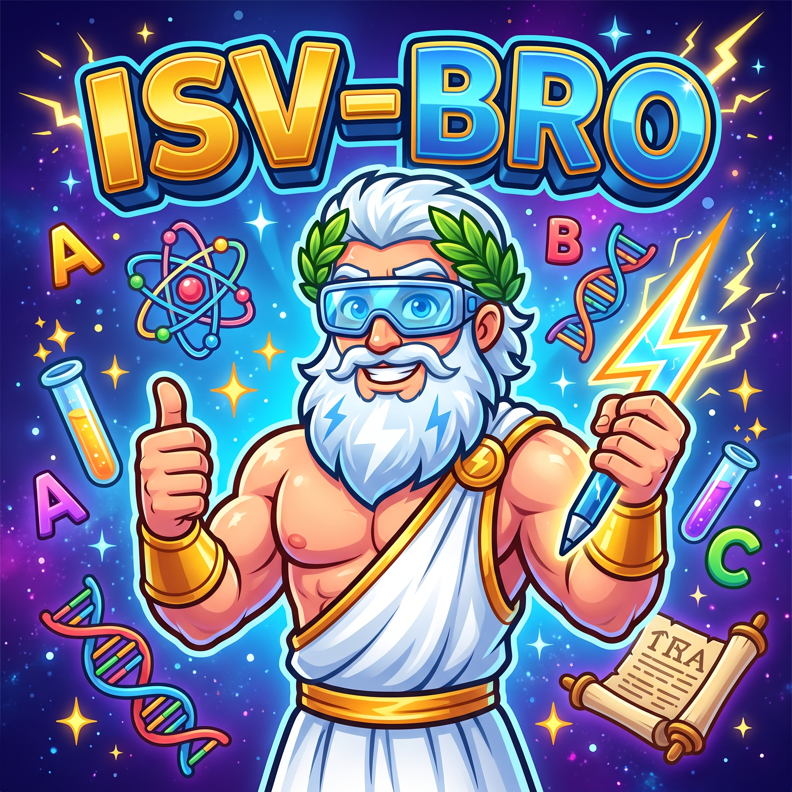

<p align="center">
  
</p>

<h1 align="center">ISV BRO</h1>
<p align="center">
  <strong>International Scientific Vocabulary — Blast Resonance Operative</strong><br>
  <em>A Radical 90s Science Rail Shooter That Unlocks Scientific Literacy Through Etymology</em>
</p>

<p align="center">
  
  
  
  
  
</p>

---

## 🔬 The ISV Advantage: A Pedagogical Manifesto

> *"Science is not merely a collection of facts; it is a language. When you master its morphology, the entire universe becomes legible."*

### The STEM Vocabulary Wall
A major barrier for students entering biology, physics, chemistry, geology, and medicine isn't conceptual difficulty—it's **lexical intimidation**. Introductory STEM courses introduce more novel vocabulary words per semester than first-year foreign language curricula.

When scientific nomenclature is presented as isolated, arbitrary words to be memorized by brute force:
- **Cognitive overload** paralyzes problem-solving and critical thinking.
- **Rote memorization** results in steep forgetting curves within weeks of an exam.
- **Learners feel alienated**, mistaking linguistic friction for an inability to understand the underlying science.

### The Solution: International Scientific Vocabulary (ISV)
Modern scientific nomenclature is not random. Over **90% of technical terminology** across all natural sciences is derived from **International Scientific Vocabulary (ISV)**—a standardized, modular system composed of classical Greek and Latin morphemes (roots, prefixes, and suffixes).

Rather than memorizing thousands of disconnected terms, learning approximately **100 fundamental ISV roots** grants learners **deconstructive "X-Ray Vision"** across scientific disciplines:

| Compound Scientific Term | ISV Morpheme Breakdown | Immediate Decoded Meaning |
| :--- | :--- | :--- |
| **Phagocytosis** | `phago-` (eat) + `cyto-` (cell) + `-osis` (process) | The cellular process of engulfing and digesting particles |
| **Thermodynamics** | `thermo-` (heat) + `dynam-` (power/force) + `-ics` (study) | The study of heat and mechanical power relations |
| **Chromatography** | `chrom-` (color) + `-graphy` (writing/recording) | Technique for separating and recording color mixtures |
| **Lithosphere** | `lith-` (stone/rock) + `sphaera` (globe/sphere) | The rigid rocky outer shell of a terrestrial planet |
| **Bioluminescence** | `bio-` (life) + `lumin-` (light) + `-escence` (becoming) | Light production and emission by a living organism |

### Core Pedagogical Pillars
1. **Modular Decoding over Memorization:** Understanding roots turns opaque jargon into transparent, self-defining compound concepts.
2. **Cross-Disciplinary Conceptual Transfer:** Roots are not trapped in silos. The root *photo-* unlocks *photosynthesis* (biology), *photons* (quantum physics), and *photometry* (astronomy).
3. **Reduced Cognitive Load:** Students build an associative semantic lattice rather than a flat, fragile flashcard stack.
4. **Active High-Speed Retrieval:** Fast-paced gamification transforms passive recognition into lightning-fast active recall, solidifying retention through neuroplastic reinforcement.

---

## 🕹️ The Game: ISV BRO

**ISV BRO** fuses educational linguistics with the adrenaline-fueled kinetic action of classic 90s rail shooters (*Star Fox*, *Panzer Dragoon*), wrapping hardcore science pedagogy in high-octane synthwave aesthetics.

### Premise
In the late 1990s, high-energy particle accelerators tore a rift into the **Etymo-Verse**—a hyper-dimensional subspace where scientific phenomena and Latin/Greek roots materialize as volatile anomalies.

You pilot the experimental **Hadron Jet** alongside **B.R.O.** (*Blaster Research Officer*), your sunglasses-wearing, hyperactive AI hype-man stationed inside your cockpit HUD. Your mission: blast through hazard-choked quantum test chambers, neutralizing rogue anomalies by synthesizing their correct ISV roots before cognitive overheat melts your reactor core.

### Key Gameplay Features
- **6DOF Screen-Bounded Flight:** Smooth 3D flight inside a bounded viewport. Execute tactical airbrakes, afterburner boosts, and hazard-deflecting barrel rolls granting brief invulnerability frames.
- **Resonant Lock-On Combat:** Soft-lock onto approaching anomalies displaying scientific definitions. Quickly identify and trigger the matching Latin/Greek root (`1-4` / `Q-E`) to fire resonant laser salvos.
- **Cognitive Overheat System:** Incorrect root selections spike the Hadron Jet’s Cognitive Overheat meter (+25%). Reaching 100% forces an emergency coolant vent—locking weapons and leaving your ship vulnerable.
- **The "Bro-Factor" Combo Multiplier:** Chain consecutive correct answers to elevate your score multiplier from `1x` to `8x ("RADICAL!")` while B.R.O. hypes up your etymological mastery.
- **Multi-Stage Boss Exams:** Survive sector gauntlets to face monumental bosses (*The Mitochondrion Overlord*, *The Lithic Golem*, *The Quantum Singularity*) that require multi-root sequential synthesis under intense bullet-pattern fire.
- **Adaptive Spaced Repetition Engine:** Missed or hesitant roots are automatically logged in `user://isv_save.json` and served with higher frequency in subsequent runs until fluency is achieved.
- **Codex Bro-tanica:** An extensive in-game compendium documenting all unlocked Greek/Latin roots, etymological derivations, definitions, and real-world scientific applications.

---

## 🌌 The 8 Scientific Sectors

ISV BRO features a comprehensive curriculum of **96 curated ISV roots** spanning 8 distinct scientific disciplines:

| Sector | Code | Discipline & Focus | Theme Color | Featured Soundtrack |
| :---: | :---: | :--- | :---: | :--- |
| **01** | `BIO` | **Cytology & Bio-Genesis**<br>Roots: `bio-`, `cyto-`, `soma-`, `phag-`, `blast-`, `-lysis`, etc. | Neon Lime (`#39FF14`) | *The Run* |
| **02** | `ASTRO` | **Astro & Celestial Dynamics**<br>Roots: `astro-`, `cosmo-`, `helio-`, `peri-`, `apo-`, `-orbit`, etc. | Electric Cyan (`#00F0FF`) | *Ultrabeat* |
| **03** | `GEO` | **Geo & Lithospheric Matrix**<br>Roots: `geo-`, `lith-`, `petro-`, `pyro-`, `morph-`, `-strat`, etc. | Solar Yellow (`#FFE600`) | *Undercurrent* |
| **04** | `THERMO` | **Thermo & Quantum Energetics**<br>Roots: `thermo-`, `kinet-`, `tachy-`, `photo-`, `chrom-`, etc. | Hot Magenta (`#FF007F`) | *Escape* |
| **05** | `GENOME` | **Genetics & Genomic Code**<br>Roots: `gen-`, `mut-`, `poly-`, `hetero-`, `homo-`, `trans-`, etc. | Plasma Purple (`#A855F7`) | *The Flight* |
| **06** | `PARTICLE` | **Subatomic & Particle Dynamics**<br>Roots: `atom-`, `electron-`, `grav-`, `nucl-`, `rad-`, `iso-`, etc. | Radiant Pink (`#FF2A85`) | *The Key* |
| **07** | `SONIC` | **Acoustic & Optical Resonance**<br>Roots: `son-`, `phon-`, `opt-`, `lum-`, `spectr-`, `reson-`, etc. | Mint Emerald (`#05FFA1`) | *Understanding* |
| **08** | `CYBER` | **Cybernetics & Bionic Automata**<br>Roots: `cyber-`, `bion-`, `tele-`, `auto-`, `mech-`, `syn-`, etc. | Laser Orange (`#FF6B00`) | *Luck* |

---

## 🚀 Getting Started

### Prerequisites
- [Godot Engine 4.3+](https://godotengine.org/download) or **4.7+** (Standard edition, Forward+ rendering)

### Clone & Launch
```bash
# Clone the repository
git clone https://github.com/leouofa/isv-bro.git
cd isv-bro

# Option A: Open with Godot GUI
# Open Godot Engine, click "Import", select the project.godot file, and press "Edit" or "Run"

# Option B: Launch directly via Godot CLI
godot --path . scenes/MainMenu.tscn
```

### Running Automated Verification
ISV BRO includes an automated test suite verifying scene compilation, lexicon integrity, audio channels, and game subsystems:

```bash
godot --headless --script tools/test_game.gd
```

---

## 🎮 Flight Deck Controls

| Action | Keyboard Controls | Gamepad (Xbox / PlayStation) |
| :--- | :---: | :---: |
| **Steer Hadron Jet (Viewport Pitch/Yaw)** | `W` `A` `S` `D` / Arrow Keys | Left Analog Stick |
| **Space Laser Salvo** | `Spacebar` | Right Trigger / `R2` |
| **Focus Time-Slow (Chrono Energy)** | `Shift` (Hold) | Left Trigger / `L2` |
| **Afterburner Boost** | `W` (Hold) / `Up Arrow` | `D-Pad Up` |
| **Airbrake** | `S` (Hold) / `Down Arrow` | `D-Pad Down` |
| **Deflective Barrel Roll** | Double-tap `A` or `D` | `L1` / `R1` (LB / RB) |
| **Select Root 1 (Option A)** | `1` / `Q` | `A` / `Cross` |
| **Select Root 2 (Option B)** | `2` / `E` | `B` / `Circle` |
| **Select Root 3 (Option C)** | `3` / `R` | `X` / `Square` |
| **Select Root 4 (Option D)** | `4` / `F` | `Y` / `Triangle` |
| **Codex Bro-tanica** | `B` | `Select` / `Touchpad` |
| **Pause / Flight Computer** | `Escape` | `Start` / `Options` |

---

## 📜 Licensing

This repository operates under a **Dual License** structure:

### 1. Game Engine & Source Code — MIT License
All software source code (`scripts/`, `scenes/`, `shaders/`, `tools/`), 3D models (`assets/models/`), UI themes, and documentation are licensed under the permissive **[MIT License](LICENSE)**:

```text
Copyright (c) 2026 Leonid (@leouofa)
Permission is hereby granted, free of charge, to any person obtaining a copy
of this software and associated documentation files...
```

You are welcome to inspect, study, fork, modify, and build upon the codebase.

### 2. Original Soundtrack (OST) — All Rights Reserved
> [!IMPORTANT]
> All 14 original musical compositions and audio recordings located in the `tracks/` directory (*The Run, Ultrabeat, Undercurrent, Escape, Left Turn, Rerun, Entryway, Mirror Tech, The Flight, The Key, Understanding, Luck, Low Cut, The End*) are **Proprietary & All Rights Reserved** by Leonid (@leouofa).
>
> The music tracks are **excluded** from the MIT License. Unauthorized redistribution, remixing, commercial synchronization, or standalone re-uploading of these audio tracks without explicit prior written consent is strictly prohibited.

---

## 👤 Author & Acknowledgments

- **Concept, Design & Development:** Leonid ([@leouofa](https://github.com/leouofa))
- **Engine:** Built with [Godot Engine](https://godotengine.org)
- **Special Thanks:** The linguists, scientists, and educators who keep the roots of scientific discovery alive.
